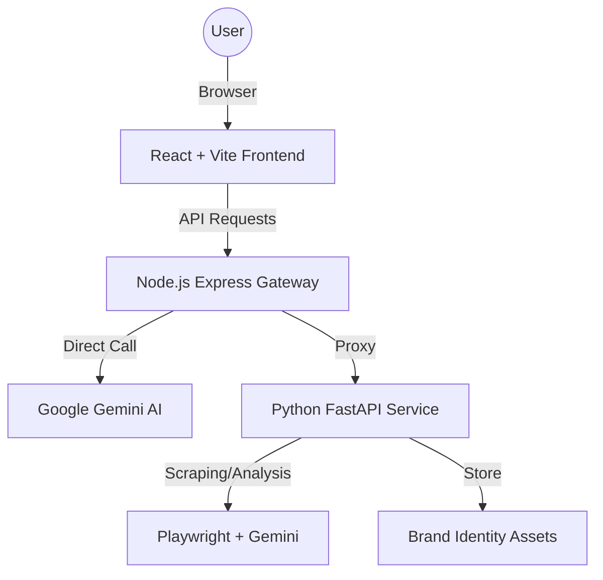

# GenFashion Atelier 🎨👗

**GenFashion Atelier** is a state-of-the-art AI-powered platform designed to revolutionize the fashion design and marketing workflow. By leveraging Google's Gemini models, it provides an end-to-end creative suite for fashion brands—from automated brand asset ingestion to high-fidelity virtual try-ons and personalized campaign generation.

---

## 🏗️ System Architecture

The application is built with a microservices-aligned architecture, unified for seamless deployment:



---

## ✨ Key Features

### 1. Brand Intelligence & Ingestion
Analyze any brand's digital presence to extract its unique "vibe."
*   **Automatic Asset Discovery:** Scrapes logos, favicons, and key brand imagery.
*   **Semantic Style Extraction:** Identifies core aesthetic keywords, color palettes (with hex codes), and typography using Gemini 2.5 Flash.
*   **Automated Brand Book:** Generates a professional PDF report summarizing the brand's identity.

### 2. Virtual Try-On (VTO)
A photorealistic virtual fitting room powered by `gemini-3-pro-image-preview`.
*   **Garment Warping:** Realistically fits clothing items onto user-uploaded photos.
*   **Intelligent Styling:** Suggests matching items from the catalog to complete an outfit.
*   **Multi-Item Support:** Layer multiple garments for a full look.

### 3. Editorial Image Generation
Transform product photography into high-end editorial content.
*   **Product-to-Model:** Converts flat-lays or mannequin shots into "on-model" shots.
*   **Scene Synthesis:** Automatically generates brand-aligned backgrounds and environments.
*   **Diverse Model Selection:** Supports a wide range of AI-generated models for better representation.

### 4. Lookbook & Campaign Automation
Scale creativity with automated content generation.
*   **Dynamic Lookbooks:** Create themed collections (e.g., "Nordic Winter", "Urban Summer") in seconds.
*   **Personalized Campaigns:** Generate targeted marketing visuals and copy tailored to specific customer segments.

---

## 🛠️ Tech Stack

- **Frontend:** React 19, TypeScript, Vite, Tailwind CSS, Framer Motion.
- **Backends:** 
    - **Node.js Gateway:** Handles API orchestration, authentication, and static file serving.
    - **Python Service:** Specialized in web scraping (Playwright) and complex PDF generation (ReportLab).
- **AI Infrastructure:**
    - `gemini-2.5-flash`: For text analysis, JSON parsing, and general logic.
    - `gemini-3-pro-image-preview`: For high-fidelity image synthesis and VTO.
    - `vertex-ai`: Primary deployment target for enterprise AI stability.

---

## 🚀 Getting Started

### Prerequisites
- Node.js 18+
- Python 3.10+
- Google Cloud Project with Gemini API enabled.

### Local Installation

1. **Clone the project:**
   ```bash
   git clone https://github.com/your-username/genfashion-atelier.git
   cd genfashion-atelier
   ```

2. **Server Configuration:**
   Create a `.env` file in the root:
   ```env
   GEMINI_API_KEY=your_api_key
   GOOGLE_CLOUD_PROJECT=your-project-id
   GOOGLE_CLOUD_LOCATION=us-central1
   ```

3. **Install & Run (Manual):**
   ```bash
   # Terminal 1: Python Backend
   cd backend
   python -m venv venv
   source venv/bin/activate
   pip install -r requirements.txt
   python main.py

   # Terminal 2: Node Gateway
   cd ..
   npm install
   npm run server

   # Terminal 3: Frontend
   npm run dev
   ```

---

## ☁️ Deployment

### Cloud Run (Recommended)
This project is configured for a unified Cloud Run deployment using the provided `deploy_lookbook.sh` script.

1. **Authenticate gcloud:**
   ```bash
   gcloud auth login
   gcloud config set project YOUR_PROJECT_ID
   ```

2. **Run Deployment Script:**
   ```bash
   chmod +x deploy_lookbook.sh
   ./deploy_lookbook.sh
   ```

The script builds a unified container containing both the Node.js and Python services, making it easy to manage as a single scale-to-zero service.

---

## 📄 License
SPDX-License-Identifier: Apache-2.0

